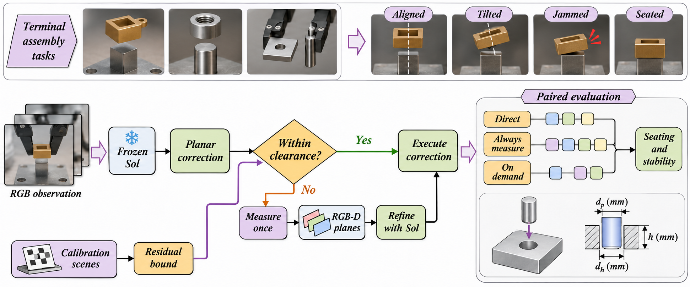
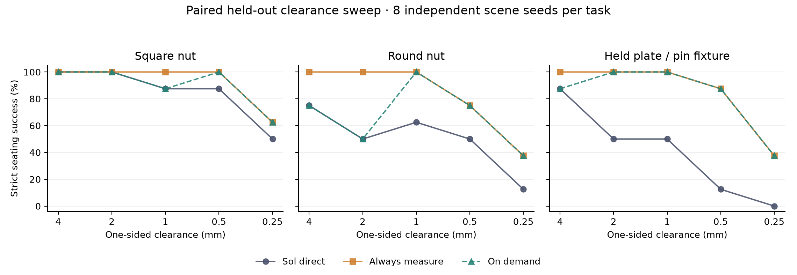
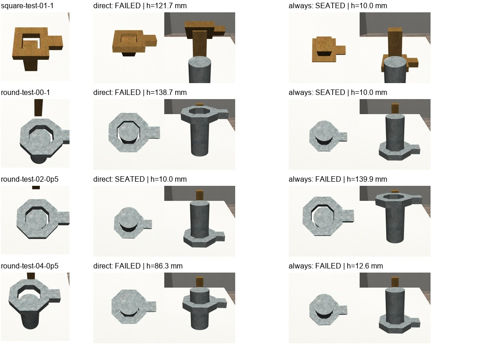

# 独立装配公差实验

**结论**　按需测量消费 72/120 次额外测量，严格就位 96/120；始终测量为 120/120 次、104/120 就位。节省 40% 测量，但未达到预定非劣标准。方孔直接控制首次跌破 90% 的观测档位是 1 mm；圆孔和持件夹具在扫描起点 4 mm 已低于此线，较宽端的转折点未定位。

在按需跳过的 48 个条件中，32° 斜视的 19 个条件有 8 个因漏测失败；0° 和 20° 的 29 个条件中未出现相对始终测量的损失。这个分层是在查看结果后得到的，适合作为下一批独立样本的预注册假设。

傲飞 1 号运行 robosuite 1.4.0 / MuJoCo，模型图像调用由本机转发。GPT-6.2 Sol 与 GPT-6.1 Terra 为请求标识。主实验 12 个校准种子、24 个独立测试种子，每个种子配对扫描五档单边间隙。压力测试另用 12 个种子。每个请求使用一张匿名图像。

## 实验一 · 评分验证

已知姿态包括就位、半插、倾斜、悬空与脱离。在 3 类几何、5 档间隙中，严格几何判据符合构造标签 75/75，原生判据符合 65/75。10 个分歧均为持件夹具上的倾斜与半插。编号图像双视角模型盲核 45 例，33 例判对，0 例判错，12 例遮挡无法判读。没有人工盲审。

最紧间隙的数值敏感性检查中，2 ms 与 1 ms 两种步长下，方孔 56/56 对、圆孔 46/56 对得到相同就位判定。圆孔在最紧档具有可见的积分步长敏感性。

## 实验二 · 公差扫描

固定初始平行姿态，独立随机场景包含平面偏移、装夹高度、相机俯角及位置。表内各格分母 8。预先指定观察成功率低于 90% 为不稳定。每任务每档一例失败就会越线，因此阈值是观测档位。

|任务 / 策略|4 mm|2 mm|1 mm|0.5 mm|0.25 mm|
|---|---:|---:|---:|---:|---:|
|方孔 / Sol 直接|8|8|7|7|4|
|方孔 / Sol 始终测量|8|8|8|8|5|
|方孔 / Sol 按需|8|8|7|8|5|
|方孔 / Terra 直接|4|3|3|3|2|
|方孔 / 准确动作参考|8|8|8|8|8|
|圆孔 / Sol 直接|6|4|5|4|1|
|圆孔 / Sol 始终测量|8|8|8|6|3|
|圆孔 / Sol 按需|6|4|8|6|3|
|圆孔 / Terra 直接|4|3|3|3|0|
|圆孔 / 准确动作参考|8|8|8|8|8|
|持件夹具 / Sol 直接|7|4|4|1|0|
|持件夹具 / Sol 始终测量|8|8|8|7|3|
|持件夹具 / Sol 按需|7|8|8|7|3|
|持件夹具 / Terra 直接|4|1|1|0|0|
|持件夹具 / 准确动作参考|8|8|8|8|8|

在 1 mm 下另测倾斜和遮挡，允许模型同时输出平移、横滚和方件偏航。每任务 4 个新种子配对生成四类条件。8–14° 初始横滚，方件另加 8–16° 偏航，合成遮挡条宽 36 个像素。每格分母为 12。

|条件|Sol|Terra|准确动作|
|---|---:|---:|---:|
|平行|8|1|12|
|倾斜|6|0|12|
|遮挡|7|1|12|
|倾斜且遮挡|4|0|12|

## 实验三 · 三策略配对比较

|任务|直接|始终测量|按需测量|按需测量次数|
|---|---:|---:|---:|---:|
|方孔|34/40|37/40|36/40|16/40|
|圆孔|20/40|33/40|27/40|24/40|
|持件夹具|16/40|34/40|33/40|32/40|
|全部|70/120|104/120|96/120|72/120|

按需减始终的配对成功率差 -6.67 个百分点，按任务分层、按种子配对重抽样的 95% 区间 [-10.83, -2.50]。预定非劣界为 −5 个百分点。按需相对始终由成转败 8 例，由败转成 0 例。仅自由释放的两个任务为按需 63/80，始终 70/80。
测量使用渲染深度和带 0.65 mm 噪声的平面直方图，无物体掩膜或真值位姿。三组从同一输入出发，事后按预先锁定的规则选择已实测的潜在动作并在服务器回放。节省的是部署时会消费的额外测量次数，未实测在线节拍。阈值方孔 0.79、圆孔 1.23、持件夹具 2.04 mm，均为任务级，不是逐帧不确定性估计。

## 失败案例

- square-test-01-1（skipped_measurement_failed）。理想平移 (-4.11, 6.06) mm，直接动作 [-4.1, 11.2]，补测动作 [-4.5, 6.2]。最终高度 121.67 / 9.99 mm，横向偏差 11.87 / 0.40 mm。按需测量触发状态为 False。
- round-test-00-1（measurement_recovered）。理想平移 (-2.60, 5.48) mm，直接动作 [-4.0, -1.6]，补测动作 [-3.1, 7.2]。最终高度 138.73 / 9.99 mm，横向偏差 7.73 / 1.06 mm。按需测量触发状态为 True。
- round-test-02-0p5（measurement_hurt）。理想平移 (-2.12, 4.46) mm，直接动作 [-3.3, 1.6]，补测动作 [-6.6, 5.5]。最终高度 9.99 / 139.89 mm，横向偏差 0.32 / 4.54 mm。按需测量触发状态为 True。
- round-test-04-0p5（both_failed）。理想平移 (-0.56, -9.17) mm，直接动作 [-0.6, -10.2]，补测动作 [-2.1, -9.0]。最终高度 86.31 / 12.60 mm，横向偏差 0.12 / 0.39 mm。按需测量触发状态为 True。

方孔和圆孔高度相对于桌面，夹具相对于柱顶。全部回合保留在 test-outcomes.json。

## 限制与复核

单臂两项检验的是理想横向纠偏后的自由释放。双臂项保留原生工件几何，固定持件坐标系，通过受阻进给检验对准，没有在线双臂控制或完整抓取。主扫描每任务每档只有八个独立种子；相同种子跨公差重复使用，测试工件资产与校准相同。已修正圆柱半高索引，并以新种子重跑全部圆孔实验。圆孔柱顶距离估计的中位绝对误差约 0.05 mm。最终回放在每次动作之前重置完整仿真动力学状态。

原始文件包括 protocol.txt、locked-gate.json、manifest.json、responses/、stress-responses/、scores.json、stress-scores.json、timestep-check.json、fixtures.json 和 blinded-visual-audit.json。图中 ImageGen 工件只用于示意，失败案例图来自实际回放。
