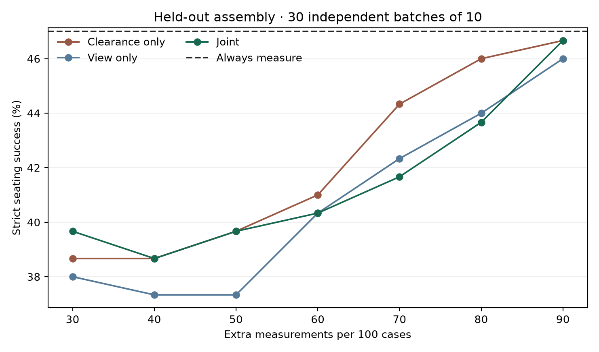
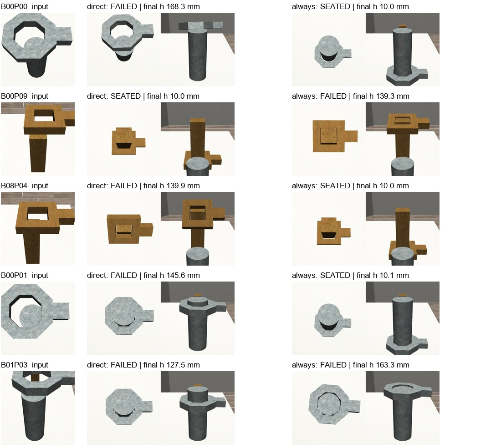

# 独立测试：按公差和图像质量分配测量预算

主预算下每批 10 件测 6 件，共 180/300 次。只看公差成功 123/300，只看视角 121/300，联合 121/300，始终测量 141/300。连续通过预设非劣检验的最大已测节省比例为 10%（零表示所有少测档位均未得到确认）。

## 设计
30 个独立工作批次，每批 10 个新种子。批内平衡五档间隙和五档新视角，配对比较相同额外测量次数。五档间隙为 0.25、0.5、1、2、4 mm，视角为 8、14、26、38、45°。固定装夹体抬高 10–42 mm，接触前移动件中心高于柱顶 36–50 mm。此前测试夹具未抬高，接近高度为 12–34 mm。几何和控制约束与上一轮相同。每幅图像独立、匿名送入请求标识 gpt-6.2-sol 的推理接口。物理场景、额外深度观测、执行和评分运行于傲飞 1 号。每个回合两种潜在动作都实际推理、回放，四种策略的在线测量数按预锁定决策计数。

公差规则优先最小间隙，视角规则优先最大倾角。联合规则使用间隙、视角和初始 RGB 中心区域亮度梯度能量预测补测的成功收益；线性岭回归仅在上一轮 120 个样本上拟合。未读取测试夹具高度、真实偏移或补测深度。先对同批的十张初始图排序再分配预算；本实验没有验证逐件流式阈值或实际生产节拍。

## 相同预算的比较

|每 10 件测几件|总测量次数|公差|视角|联合|同学习器仅公差|同学习器仅视角|始终测量|
|---:|---:|---:|---:|---:|---:|---:|---:|
|3|90|116|114|119|121|114|141|
|4|120|116|112|116|121|112|141|
|5|150|119|112|119|131|112|141|
|6|180|123|121|121|136|121|141|
|7|210|133|127|125|137|127|141|
|8|240|138|132|131|138|132|141|
|9|270|140|138|140|140|138|141|

主预算预先固定为 60%。下列差异单位均为百分点。95% 区间为双侧批次配对 t 区间，优效性检验为单侧并做 Holm 两项校正。
- 联合减只看公差：-0.67，区间 [-4.93, 3.60]，校正 p=1，配对胜/负 21/23。
- 联合减只看视角：-0.00，区间 [-2.77, 2.77]，校正 p=1，配对胜/负 9/9。

## 与始终测量的非劣检验

边界为严格就位率相差不超过 5 个百分点。采用预先登记的单侧 5% 水平分布无关 e 检验（拒绝阈值 20），从省 10% 依次向下检验，首次未通过以后停止正式判定。所附单侧 t 下限用于描述，不代替正式判据。

|省测量|联合−始终（百分点）|联合胜 / 负|单侧 t 下限|e 值|固定序贯结论|
|---:|---:|---:|---:|---:|---|
|10%|-0.33|6 / 7|-2.41|755.9|通过|
|20%|-3.33|7 / 17|-5.54|2.148|未通过|
|30%|-5.33|11 / 27|-7.60|0.4869|仅描述|
|40%|-6.67|14 / 34|-9.64|0.3146|仅描述|
|50%|-7.33|19 / 41|-10.78|0.31|仅描述|
|60%|-8.33|24 / 49|-12.57|0.278|仅描述|
|70%|-7.33|32 / 54|-12.01|0.404|仅描述|

## 分任务结果（主预算）

|任务|场景数|仅 RGB|只看公差|只看视角|联合|始终测量|
|---|---:|---:|---:|---:|---:|---:|
|方孔套柱|101|52|48|48|48|48|
|圆孔套柱|98|45|49|41|37|52|
|持件轴孔几何夹具|101|17|26|32|36|41|

## 失败回放

以下案例来自 60% 预算，按既定类别选择，优先显示自由释放的套柱任务。只有 1–6 名能分到测量。方孔、圆孔的末态高度为零件中心相对于桌面，持件夹具为相对于柱顶。
- **B00P00 · 联合漏测**。圆孔套柱，2.0 mm，26°，夹具抬高 34.4 mm。公差、视角、联合三个排名分别 7、6、7。直接 / 补测动作 [7.3, 32.0] / [12.5, -4.0] mm，末态高度 168.27 / 9.99 mm，末态横向偏差 37.97 / 0.13 mm。
- **B00P09 · 补测后反而失败**。方孔套柱，1.0 mm，45°，夹具抬高 19.1 mm。公差、视角、联合三个排名分别 5、1、2。直接 / 补测动作 [-13.7, -4.3] / [-13.8, -8.1] mm，末态高度 9.99 / 139.34 mm，末态横向偏差 0.38 / 0.73 mm。
- **B08P04 · 联合补测成功，至少一个简单规则漏测**。方孔套柱，2.0 mm，45°，夹具抬高 19.9 mm。公差、视角、联合三个排名分别 8、2、2。直接 / 补测动作 [-15.5, 4.2] / [-14.7, 10.8] mm，末态高度 139.86 / 9.99 mm，末态横向偏差 12.24 / 1.88 mm。
- **B00P01 · 简单规则挽回联合漏测**。圆孔套柱，0.25 mm，8°，夹具抬高 37.4 mm。公差、视角、联合三个排名分别 1、10、8。直接 / 补测动作 [12.9, -5.4] / [5.8, 0.0] mm，末态高度 145.55 / 10.13 mm，末态横向偏差 0.12 / 0.35 mm。
- **B01P03 · 两种动作都失败**。圆孔套柱，0.25 mm，45°，夹具抬高 39.1 mm。公差、视角、联合三个排名分别 2、2、3。直接 / 补测动作 [-7.7, -7.7] / [-6.2, -10.0] mm，末态高度 127.46 / 163.35 mm，末态横向偏差 0.05 / 0.27 mm。

全量仅 RGB 为 114/300，准确动作参考为 300/300。方孔和圆孔为理想末段纠偏后的自由释放。轴孔夹具为持件几何进给，不代表机器人双臂闭环。各组共用物理执行器、动作和评分，未测试新工件、真机、连续在线预算调度或延迟。超出本轮所测预算的节省比例未验证。

协议 protocol.txt；拟合系数 locked-weights.json；先于推理保存的全部决策 locked-ranks.json；每次提示和回答 responses/；逐例真值、排名、动作和物理末态 case-outcomes.json；预算结果 budget-results.csv。

