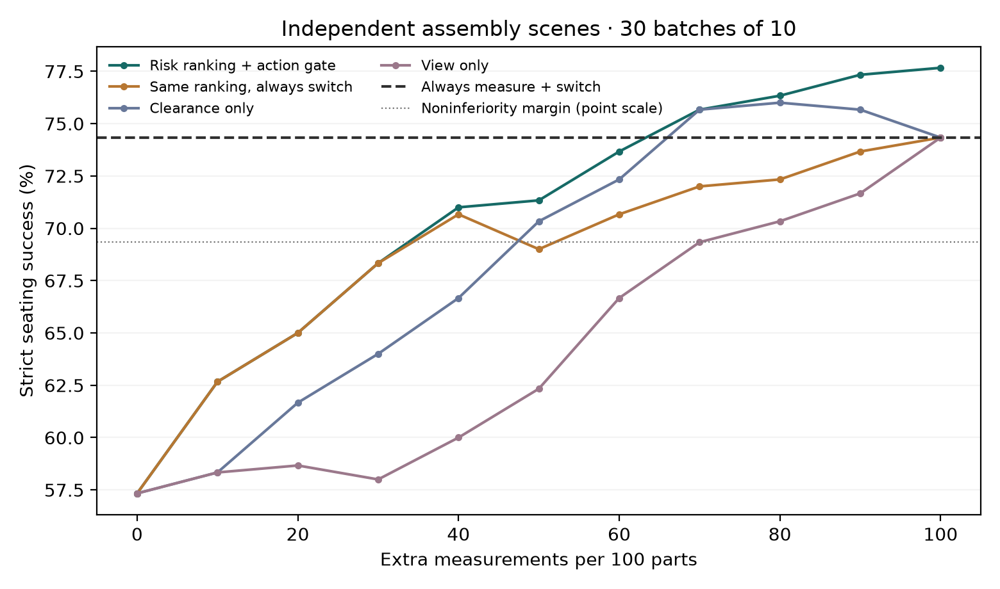
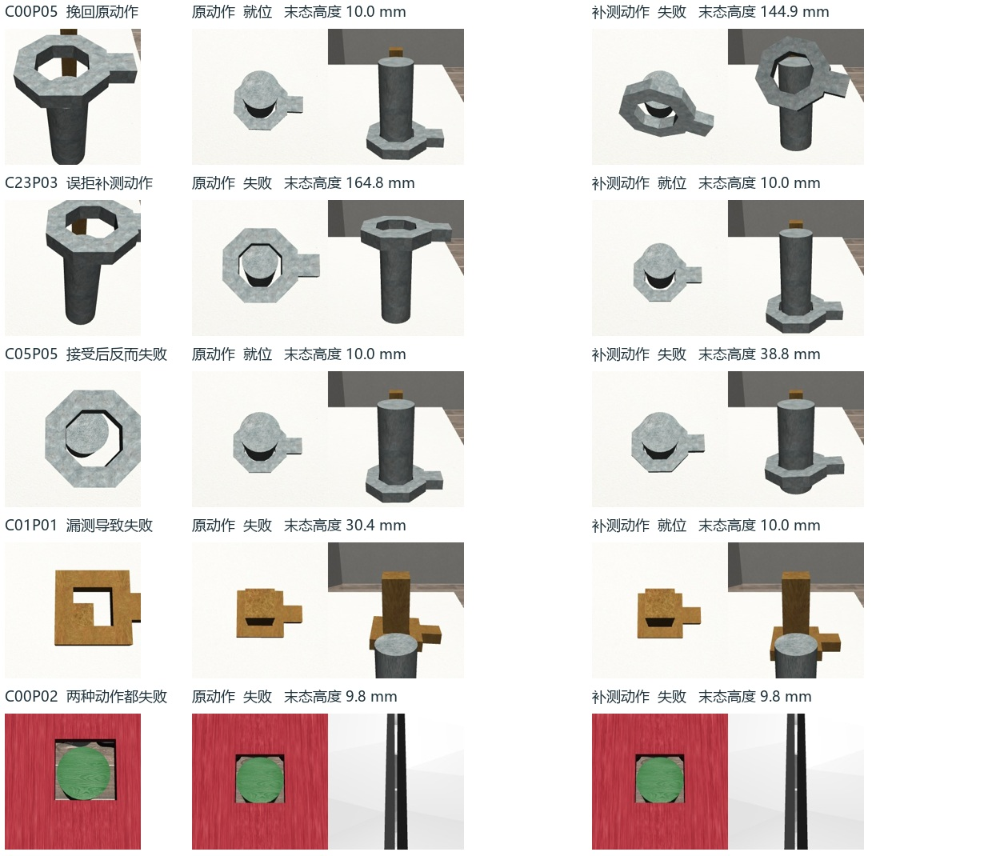

# 实验 03｜测量后是否保留原动作

独立仿真共 300 件。纯 RGB 原动作成功 172/300，每件都测并采用新动作成功 223/300，每件都测并启用接受门控成功 233/300。理想纠偏成功 300/300。三类几何共用同一严格就位判据框架。

## 两个预设预算

**少测 20%**。测 240 次，风险排序与动作门控成功 229/300（76.3%）。比始终测量相差 +2.00 个百分点，单侧 95% 配对 t 下限 -1.59，批次 bootstrap 下限 -1.33，单侧非劣 p = 0.001236。按预设顺序判定为**通过**。逐例胜/负为 23/17。
相同名单一律采用补测动作为 217/300。门控保留原动作 52 次，挽回 15 件，误拒 3 件。同预算净增益 +4.00 个百分点（双侧 95% 区间 +1.12 至 +6.88）。它接受了 188 个补测动作，其中 6 次让原本可成功的动作变为失败。未选中测量的零件中，14 件本可由补测挽回。
只按公差、只按视角选件后直接用补测动作分别为 228/300 和 211/300。相对全量测量也启用门控的对照，差值 -1.33 个百分点（描述性）。

**少测 40%**。测 180 次，风险排序与动作门控成功 221/300（73.7%）。比始终测量相差 -0.67 个百分点，单侧 95% 配对 t 下限 -4.73，批次 bootstrap 下限 -4.67，单侧非劣 p = 0.04034。按预设顺序判定为**通过**。逐例胜/负为 25/27。
相同名单一律采用补测动作为 212/300。门控保留原动作 27 次，挽回 10 件，误拒 1 件。同预算净增益 +3.00 个百分点（双侧 95% 区间 +0.57 至 +5.43）。它接受了 153 个补测动作，其中 4 次让原本可成功的动作变为失败。未选中测量的零件中，26 件本可由补测挽回。
只按公差、只按视角选件后直接用补测动作分别为 217/300 和 200/300。相对全量测量也启用门控的对照，差值 -4.00 个百分点（描述性）。

## 动作接受的上限与失败案例

全量配对回放中，补测把 80 件从失败变成成功，也把 29 件从成功变成失败。若事后总能选对两动作中可行的一个，能成功 252/300；两者都失败的有 48 件。事后选择只用来估计两动作间可利用的差异。

案例按每批测 6 件的策略、按类别取第一个未展示的编号。原动作与补测动作均从同一初始状态执行。自由释放任务的高度相对桌面，持件夹具的高度相对柱顶。

- **C00P05 · 挽回原动作**。圆孔，间隙 2 mm，俯角 42°，装夹抬高 25.9 mm，批内测量优先级第 5。原动作 [5.1, -5.5] mm，末态高度 9.99 mm，横向偏差 1.83 mm。补测动作 [6.0, -40.0] mm，末态高度 144.87 mm，横向偏差 30.42 mm。
- **C23P03 · 误拒补测动作**。圆孔，间隙 4 mm，俯角 42°，装夹抬高 30.5 mm，批内测量优先级第 6。原动作 [-8.0, -8.7] mm，末态高度 164.81 mm，横向偏差 8.58 mm。补测动作 [-8.7, 2.4] mm，末态高度 9.99 mm，横向偏差 0.13 mm。
- **C05P05 · 接受后反而失败**。圆孔，间隙 0.5 mm，俯角 6°，装夹抬高 26.6 mm，批内测量优先级第 5。原动作 [-8.6, 16.2] mm，末态高度 9.99 mm，横向偏差 0.27 mm。补测动作 [-7.2, 16.8] mm，末态高度 38.76 mm，横向偏差 0.39 mm。
- **C01P01 · 漏测导致失败**。方孔，间隙 0.5 mm，俯角 12°，装夹抬高 7.6 mm，批内测量优先级第 9。原动作 [-16.1, -2.3] mm，末态高度 30.38 mm，横向偏差 0.25 mm。补测动作 [-16.4, -3.7] mm，末态高度 9.99 mm，横向偏差 0.27 mm。
- **C00P02 · 两种动作都失败**。持件轴孔，间隙 0.25 mm，俯角 6°，装夹抬高 31.5 mm，批内测量优先级第 7。原动作 [-0.7, 2.3] mm，末态高度 9.80 mm，横向偏差 0.47 mm。补测动作 [-0.9, 2.5] mm，末态高度 9.80 mm，横向偏差 0.67 mm。

## 实验与统计口径

场景生成、深度测量、两动作执行和失败回放在傲飞 1 号完成。300 个种子及六个俯角与实验 01、02 去重，三类几何沿用。每批 10 件，每类至少 3 件；装夹抬高 6–48 mm，接近高度 34–52 mm。仅测试末段平移；圆孔最紧公差在前轮观察到积分步长敏感性。模型标识 gpt-6.2-sol，单场景两次独立匿名图像请求，正式数据统一使用实验 02 的提示。早期调度曾试用简写提示和双输出提示，全部排除。

测量前排序和测量后接受规则的参数只用实验 02 拟合，锁定于实验 03 评分前。非劣界为绝对 5 个百分点，单侧 5%，按 20% 再 40% 固定顺序检验。配对统计单位为 30 个批次，正式检验依赖批均值的近似正态；另附 50,000 次整批重抽样。由于门控可改变已测样本的动作，实验 02 的有界 e 检验不能直接移用。两个实验的正式判据不同。表外预算与强对照只做描述。

测量节省按部署时读取额外 RGB-D 的次数计算；实验为配对评分离线收集了全部 300 组读数。未计入额外模型推理时延。单次直接/补测请求也包含解码随机性，本设计不能把两种候选的全部差异归因于深度本身。

逐例数据见 case-outcomes.json；全部预算及配对统计见 summary.json；protocol.txt、policy-lock.json、isolated-responses/ 和 scores.json 分别保存冻结协议、权重与排序、推理原文和仿真末态。

**论文结论的边界**。少测 40% 时，相对始终测量且直接换动作，单侧下限仅高出非劣界 0.27 个百分点。相对始终测量也启用门控，下限为 -6.25 个百分点，跨过 −5 的边界。两个预算最直接的证据来自同名单消融：门控使成功数分别净增 12 件和 9 件。少测 40% 时，方孔成功 77/101（始终换动作 85/101），圆孔 81/101（75/101），持件轴孔 63/98（63/98）。总体非劣不能外推为每类工件均非劣。
